<div align="center">

# 🏥 Dijital Randevu Asistanı

**Hastane randevu sistemi · .NET 8 Web API · Flutter mobil uygulama · Yapay zekâ asistanı · n8n destek otomasyonu**

Hastaların randevu alıp yönettiği, doktorların ve yöneticilerin kendi panellerinden çalıştığı,
e-Devlet tarzı hesap güvenliğine sahip uçtan uca bir hastane randevu platformu.


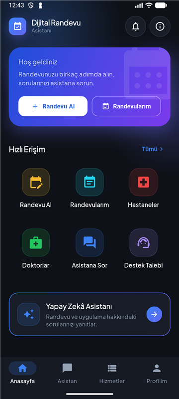
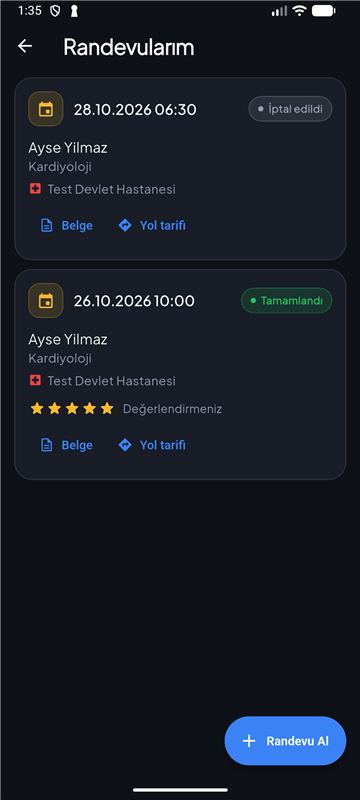
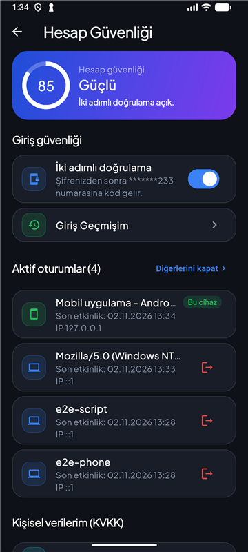

</div>

---

## 📑 İçindekiler

- [Öne çıkanlar](#-öne-çıkanlar)
- [Ekran görüntüleri](#-ekran-görüntüleri)
- [Mimari](#-mimari)
- [Özellikler](#-özellikler)
- [Kurulum](#-kurulum)
- [Çalıştırma](#-çalıştırma)
- [Testler](#-testler)
- [API özeti](#-api-özeti)
- [Proje yapısı](#-proje-yapısı)
- [Güvenlik notları](#-güvenlik-notları)
- [Lisans](#-lisans)

---

## ✨ Öne çıkanlar

| | |
|---|---|
| 📅 **Randevu** | Hastane → bölüm → doktor → gün → saat akışı, yakınlar adına randevu, erteleme, iptal, bekleme listesi |
| 🤖 **Yapay zekâ asistanı** | Yerelde çalışan Ollama (`gemma4:12b`) ile sohbet; reçete, tahlil ve randevu kâğıdı fotoğraflarını okuyup özetler; aynı soruya önbellekten anında cevap verir |
| 🛡️ **e-Devlet tarzı güvenlik** | İki adımlı doğrulama, hatalı girişte hesap kilidi, giriş geçmişi, aktif oturumlar, oturum zaman aşımı, KVKK onayı |
| 📄 **QR kodlu belge** | Randevu belgesi PDF olarak paylaşılır; herkes doğrulama koduyla belgenin gerçekliğini kontrol edebilir |
| 🎫 **Destek talebi** | Flutter → .NET API → n8n → Google Sheets; otomatik talep numarası, sorgulama, durum güncelleme |
| 💬 **WhatsApp** | Randevudan bir gün önce hatırlatma; hasta "1/2" yazarak katılımını bildirir |
| ♿ **Erişilebilirlik** | Yazı boyutu, kalın yazı ve yüksek kontrast |
| 👩‍⚕️ **Rol panelleri** | Hasta, doktor, hastane yöneticisi ve sistem yöneticisi için ayrı arayüzler |

---

## 📸 Ekran görüntüleri

> Görüntüler Android emülatöründe, geliştirme veritabanındaki test verileriyle alınmıştır.

### Hasta uygulaması

<table>
  <tr>
    <td align="center"><br/><sub><b>Ana sayfa</b> · hızlı erişim</sub></td>
    <td align="center"><br/><sub><b>Randevularım</b> · belge, yol tarifi, değerlendirme</sub></td>
    <td align="center">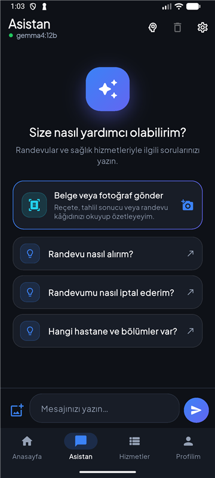<br/><sub><b>Yapay zekâ asistanı</b> · fotoğraf/belge okuma</sub></td>
  </tr>
  <tr>
    <td align="center">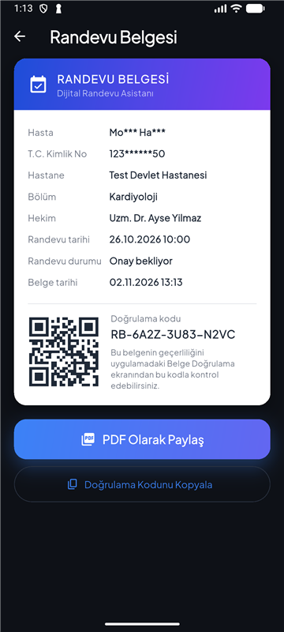<br/><sub><b>Randevu belgesi</b> · QR ve doğrulama kodu</sub></td>
    <td align="center">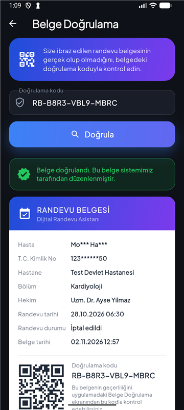<br/><sub><b>Belge doğrulama</b> · kişisel bilgiler maskeli</sub></td>
    <td align="center">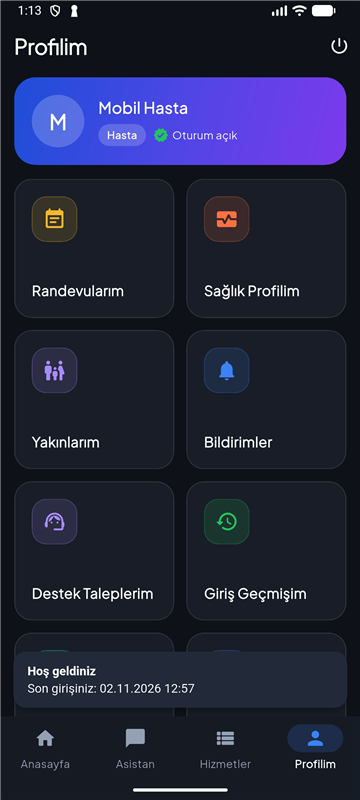<br/><sub><b>Profil</b> · girişte "son girişiniz" bildirimi</sub></td>
  </tr>
</table>

### Destek talebi (n8n + Google Sheets)

<table>
  <tr>
    <td align="center">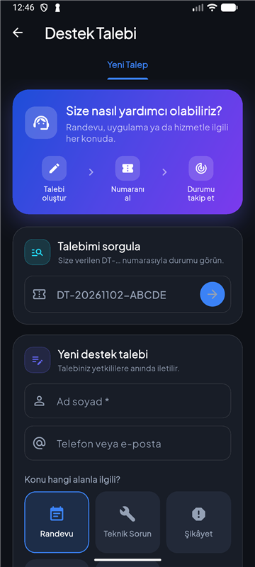<br/><sub><b>Yeni talep</b> · kategori ve öncelik</sub></td>
    <td align="center">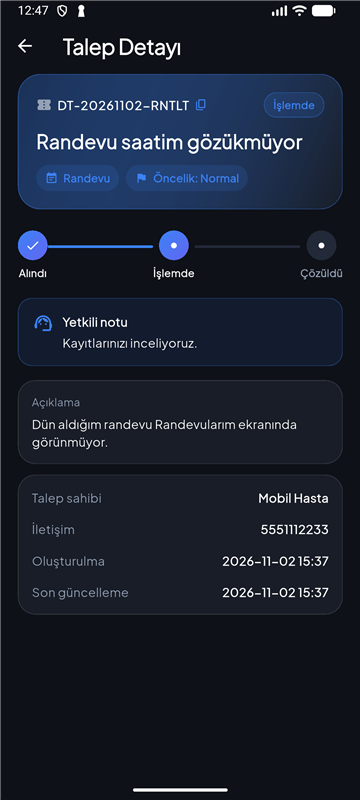<br/><sub><b>Talep detayı</b> · durum ve yetkili notu</sub></td>
  </tr>
</table>

### Hesap güvenliği

<table>
  <tr>
    <td align="center"><br/><sub><b>Hesap güvenliği</b> · 2FA ve aktif oturumlar</sub></td>
    <td align="center">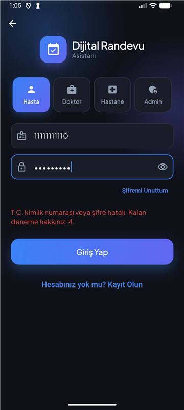<br/><sub><b>Hatalı giriş</b> · kalan deneme hakkı</sub></td>
    <td align="center">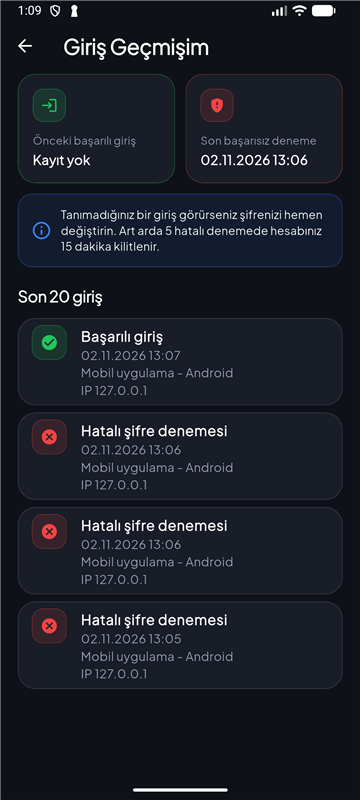<br/><sub><b>Giriş geçmişim</b> · cihaz ve IP</sub></td>
  </tr>
  <tr>
    <td align="center">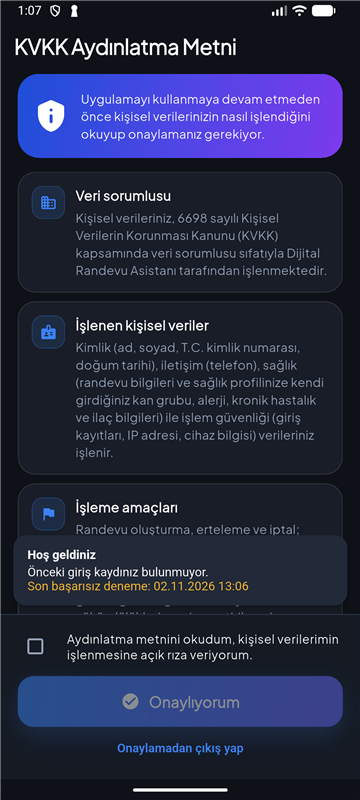<br/><sub><b>KVKK aydınlatma metni</b> · ilk girişte onay</sub></td>
    <td align="center">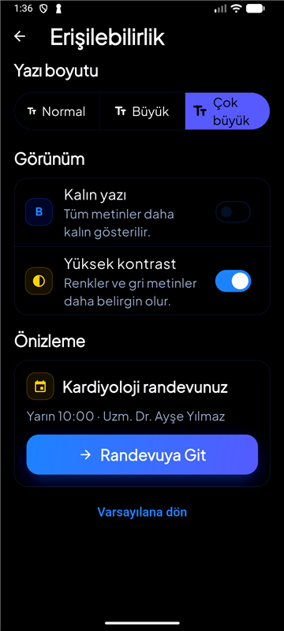<br/><sub><b>Erişilebilirlik</b> · büyük yazı + yüksek kontrast</sub></td>
    <td></td>
  </tr>
</table>

### Doktor ve yönetici panelleri

<table>
  <tr>
    <td align="center">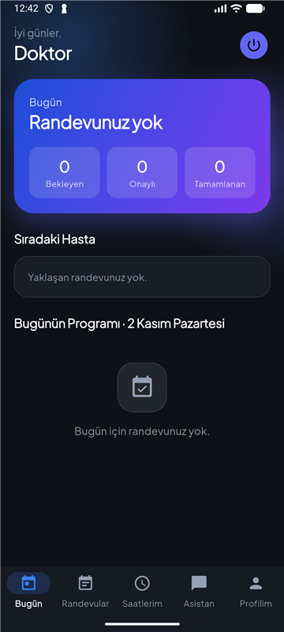<br/><sub><b>Doktor</b> · bugünün programı</sub></td>
    <td align="center">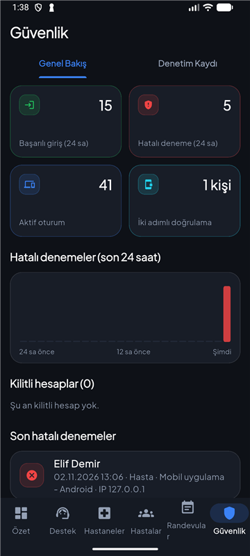<br/><sub><b>Admin · Güvenlik</b> · 24 saatlik özet</sub></td>
    <td align="center">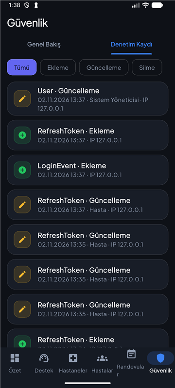<br/><sub><b>Admin · Denetim kaydı</b></sub></td>
  </tr>
</table>

---

## 🧭 Mimari

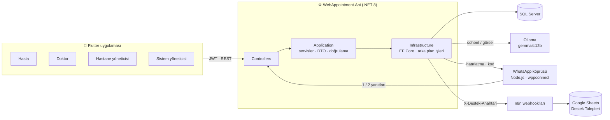

**Katmanlar (Clean Architecture):**

| Proje | Görevi |
|---|---|
| `WebAppointmentApi.Domain` | Varlıklar (`Appointment`, `Patient`, `LoginEvent`, `AppointmentDocument`, `DoctorReview`…) ve enum'lar |
| `WebAppointmentApi.Application` | İş kuralları, servis arayüzleri, DTO'lar, FluentValidation, randevu durum makinesi |
| `WebAppointmentApi.Infrastructure` | EF Core `AppDbContext`, repository'ler, JWT, Ollama/n8n/WhatsApp istemcileri, arka plan işleri |
| `WebAppointmentApi.WebApi` | Controller'lar, kimlik doğrulama, hata ara katmanı, Swagger |

Uygulama çok kiracılı (multi-tenant) yapıdadır: her kayıt bir `TenantId` taşır ve sorgular buna göre filtrelenir.

---

## 🧩 Özellikler

<details open>
<summary><b>👤 Hasta</b></summary>

- T.C. kimlik numarası ve şifreyle giriş; telefon doğrulamalı kayıt; şifremi unuttum
- Hastane → bölüm → doktor → gün → saat seçerek randevu; doktor seçerken **puan ortalaması ve son yorumlar**
- Yakınlar (çocuk, ebeveyn…) adına randevu
- Randevu **erteleme** ve **iptal**; dolu saat için **bekleme listesi**
- **Randevu belgesi** (QR kodlu, PDF paylaşımı) · **Yol tarifi** (Google Haritalar) · **Takvime ekle**
- Tamamlanan muayene için **1–5 yıldız değerlendirme** ve yorum
- Sağlık profili (kan grubu, alerji, kronik hastalık, ilaç, acil durum kişisi)
- Bildirimler; randevudan bir gün önce uygulama içi ve WhatsApp **hatırlatması**
- **Destek talebi** açma, talep numarasıyla sorgulama, kendi taleplerini takip etme
</details>

<details>
<summary><b>🤖 Yapay zekâ asistanı</b></summary>

- Yerelde çalışan Ollama modeli (`gemma4:12b`) ile Türkçe sohbet, cevaplar akış (streaming) olarak gelir
- **Bağlam hafızası:** konuşma geçmişini hatırlar
- **Cevap önbelleği:** aynı soru tekrar sorulduğunda cevabı veritabanından anında verir
- **"Düşünme" modu** açılıp kapatılabilir
- **Fotoğraf/belge okuma:** reçete, tahlil sonucu veya randevu kâğıdının fotoğrafını özetler
- Sistem talimatı `WebAppointmentApi.WebApi/AssistantPrompt.md` dosyasından okunur
</details>

<details>
<summary><b>🛡️ Hesap güvenliği (e-Devlet tarzı)</b></summary>

| Özellik | Ayrıntı |
|---|---|
| **Hatalı giriş kilidi** | Her hatalı denemede "Kalan deneme hakkınız: N"; 5 hatada hesap 15 dakika kilitlenir |
| **İki adımlı doğrulama** | Şifreden sonra telefona 6 haneli kod; 5 dakika geçerli, 5 deneme hakkı, tek kullanımlık |
| **Giriş geçmişi** | Son 20 giriş; tarih, cihaz ve IP. Girişte "Son girişiniz / son başarısız deneme" bildirimi |
| **Aktif oturumlar** | Açık cihazlar listelenir; tek tek veya "diğerlerini kapat". Kapatılan oturumun erişim anahtarı **anında** geçersiz olur |
| **Oturum zaman aşımı** | 10 dakika işlem yapılmazsa 60 saniyelik geri sayım, ardından otomatik çıkış |
| **KVKK** | İlk girişte aydınlatma metni ve açık rıza; metin sürümü değişirse yeniden onay istenir |
| **Veri hakları** | "Verilerimi indir" (PDF) ve hesap silme talebi (destek sistemine iletilir) |
| **Belge doğrulama** | `RB-XXXX-XXXX-XXXX` kodlu belgeler; doğrulama ekranında ad ve T.C. maskeli gösterilir |
</details>

<details>
<summary><b>👩‍⚕️ Doktor</b></summary>

- Bugünün programı, sıradaki hasta, bekleyen/onaylı/tamamlanan sayıları
- Randevu onaylama, tamamlama, "gelmedi" işaretleme
- Hastanın sağlık profiline randevu üzerinden erişim
- Çalışma saatleri, izinler, profil bilgileri
</details>

<details>
<summary><b>🏢 Hastane yöneticisi ve sistem yöneticisi</b></summary>

- Hastane, bölüm, doktor ve hasta yönetimi; doktor profili onayı; resmi tatiller
- Tüm randevular ve raporlar (gelmeme riski dahil)
- **Destek** sekmesi: talepleri duruma göre filtreleme, durum ve yetkili notu güncelleme
- **Güvenlik** sekmesi (sistem yöneticisi): 24 saatlik başarılı/hatalı giriş, saatlik hatalı deneme grafiği, kilitli hesaplar, aktif oturum ve 2FA kullanan kişi sayısı
- **Denetim kaydı:** ekleme/güncelleme/silme işlemlerinin kim tarafından, ne zaman, hangi IP'den yapıldığı
</details>

<details>
<summary><b>🎫 Destek talebi otomasyonu (n8n + Google Sheets)</b></summary>

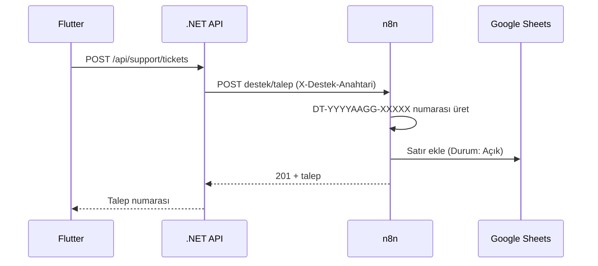

- Webhook'lar: `destek/talep`, `destek/sorgula`, `destek/durum`, `destek/liste`
- n8n iş akışının kaynağı: [`n8n/destek-talepleri.workflow.ts`](n8n/destek-talepleri.workflow.ts)
- Durumlar: Açık → İşlemde → Çözüldü / Kapatıldı
</details>

<details>
<summary><b>♿ Erişilebilirlik</b></summary>

- Yazı boyutu: Normal / Büyük / Çok büyük
- Kalın yazı ve yüksek kontrast
- Ayarlar cihazda saklanır; giriş yapmadan da kullanılabilir
</details>

---

## 🛠️ Kurulum

### Gereksinimler

| Araç | Not |
|---|---|
| [.NET 8 SDK](https://dotnet.microsoft.com/download) | Daha yeni bir SDK ile çalıştırırken `DOTNET_ROLL_FORWARD=Major` |
| [Flutter](https://docs.flutter.dev/get-started/install) | Dart 3.13+, Android SDK ve bir emülatör ya da cihaz |
| SQL Server | Yerel veya uzak |
| [Ollama](https://ollama.com) | `ollama pull gemma4:12b` |
| Node.js 20+ | WhatsApp köprüsü için (isteğe bağlı) |
| n8n + Google Sheets | Destek talepleri için (isteğe bağlı) |
| `dotnet-ef` | `dotnet tool install --global dotnet-ef` |

### 1. Depoyu klonlayın

```bash
git clone https://github.com/MahmutSibal/dijital-randevu-asistani.git
cd dijital-randevu-asistani
```

### 2. Gizli ayarları girin

`appsettings.json` içindeki gizli değerler bilerek boş bırakılmıştır. Bunları **user-secrets** ile girin:

```bash
cd WebAppointment.Api/WebAppointmentApi.WebApi
dotnet user-secrets set "ConnectionStrings:DefaultConnection" "Server=.;Database=WebAppointment;Trusted_Connection=True;TrustServerCertificate=True"
dotnet user-secrets set "Jwt:SigningKey" "<en-az-32-karakterlik-rastgele-bir-anahtar>"
dotnet user-secrets set "WhatsAppBridge:WebhookSecret" "<rastgele-bir-değer>"
dotnet user-secrets set "SupportAutomation:ApiKey" "<n8n Header Auth değeri>"
```

İsteğe bağlı: `Brevo:ApiKey`, `Brevo:SenderEmail` (e-posta), `GoogleAuth:ClientId` (Google ile giriş), `Recaptcha:SecretKey`. Geliştirme ortamında reCAPTCHA `appsettings.Development.json` ile kapalıdır.

### 3. Veritabanını oluşturun

```bash
cd WebAppointment.Api
dotnet ef database update --project WebAppointmentApi.Infrastructure --startup-project WebAppointmentApi.WebApi
```

### 4. Bağımlılıkları kurun

```bash
flutter pub get
cd mhrs-whatsapp-bot && npm install
```

WhatsApp köprüsü (`localhost:8080`), API açılırken otomatik başlatılır (`WhatsAppBridge:AutoStart`). İlk çalıştırmada terminalde çıkan QR kodu WhatsApp'tan okutun.

### 5. (İsteğe bağlı) n8n destek otomasyonu

1. n8n'de [`n8n/destek-talepleri.workflow.ts`](n8n/destek-talepleri.workflow.ts) iş akışını oluşturun.
2. Google Sheets kimlik bilgisini bağlayın; sayfada `Talepler` sekmesi ve şu sütunlar bulunsun:
   `TalepNo, OlusturmaTarihi, KullaniciId, AdSoyad, Iletisim, Kategori, Oncelik, Konu, Aciklama, Durum, GuncellemeTarihi, YetkiliNotu`
3. Webhook'lar için bir **Header Auth** kimlik bilgisi oluşturun (`X-Destek-Anahtari`) ve aynı değeri `SupportAutomation:ApiKey` olarak girin.
4. İş akışını yayınlayın (publish) ve `SupportAutomation:BaseUrl` değerini kendi n8n adresinize göre ayarlayın.

---

## ▶️ Çalıştırma

### Tek komutla (API + uygulama)

```powershell
.\scripts\dev.ps1
```

Betik API çalışmıyorsa ayrı bir pencerede başlatır, hazır olmasını bekler ve ardından `flutter run` çalıştırır. Parametreler `flutter run`'a aynen iletilir:

```powershell
.\scripts\dev.ps1 -d emulator-5554
```

VS Code'da **F5 → "Uygulama + API"** aynı işi yapar (`.vscode/launch.json`).

### Ayrı ayrı

```bash
# API → http://localhost:5233 (Swagger: /swagger)
dotnet run --project WebAppointment.Api/WebAppointmentApi.WebApi

# Uygulama
flutter run
```

### Uygulama ayarları (`--dart-define`)

| Değişken | Varsayılan | Açıklama |
|---|---|---|
| `API_BASE_URL` | `http://10.0.2.2:5233` | Emülatörden bilgisayardaki API'ye erişim. Fiziksel cihazda bilgisayarın yerel IP'sini verin |
| `IDLE_MINUTES` | `10` | Oturum zaman aşımı. Sunum için `--dart-define=IDLE_MINUTES=2` |

---

## ✅ Testler

```bash
flutter analyze
flutter test
```

Uçtan uca kontrol betikleri (API `localhost:5233`'te çalışırken, test hesaplarıyla):

| Betik | Ne kontrol eder |
|---|---|
| `scripts/dev-e2e.ps1` | Hastane, bölüm, doktor kurulumu ve temel akış |
| `scripts/dev-patient-e2e.ps1` | Sağlık profili, yakınlar, randevu, bekleme listesi, bildirimler |
| `scripts/dev-support-e2e.ps1` | Destek talebi: oluşturma, sorgulama, durum güncelleme, yetkiler |
| `scripts/dev-security-e2e.ps1` | Kalan deneme hakkı, giriş geçmişi, KVKK, belge ve doğrulama |
| `scripts/dev-account-e2e.ps1` | Aktif oturumlar, 2FA, veri dışa aktarma, değerlendirme, admin güvenlik özeti |

> Betikler test hesaplarını git'e dahil edilmeyen `DEV_TEST_ACCOUNTS.json` dosyasından okur.

---

## 🔌 API özeti

Tam liste Swagger'da (`http://localhost:5233/swagger`). Başlıcaları:

| Uç nokta | Yetki | Açıklama |
|---|---|---|
| `POST /api/auth/patient/login` | Herkes | T.C. + şifre; 2FA açıksa `202` ve doğrulama bekler |
| `POST /api/auth/patient/login/verify-code` | Herkes | 2FA kodunu doğrular |
| `GET /api/catalog/hospitals · departments · doctors` | Herkes | Randevu için katalog |
| `POST /api/appointments` · `GET /api/appointments/my` | Hasta | Randevu al / listele |
| `PUT /api/appointments/{id}/reschedule · cancel` | Hasta | Erteleme ve iptal |
| `POST /api/appointments/{id}/review` | Hasta | Doktor değerlendirmesi |
| `GET /api/reviews/doctors/averages` | Herkes | Doktor puan ortalamaları |
| `POST /api/documents/appointments/{id}` | Hasta | QR kodlu randevu belgesi |
| `GET /api/documents/verify/{code}` | Herkes | Belge doğrulama |
| `GET /api/account/security · sessions · export` | Giriş yapmış | Giriş geçmişi, oturumlar, veri dışa aktarma |
| `PUT /api/account/two-factor` | Giriş yapmış | 2FA aç/kapat |
| `POST /api/account/kvkk · deletion-request` | Giriş yapmış | KVKK onayı, hesap silme talebi |
| `POST /api/assistant/...` | Herkes | Yapay zekâ asistanı (akış) |
| `/api/support/tickets` | Herkes / Yönetici | Destek talepleri |
| `GET /api/admin/security · audit-logs` | Admin | Güvenlik özeti, denetim kaydı |

---

## 📂 Proje yapısı

```text
dijital-randevu-asistani/
├── lib/                          # Flutter uygulaması
│   ├── admin/                    # Sistem yöneticisi paneli (+ Güvenlik sekmesi)
│   ├── auth/                     # Giriş, kayıt, şifremi unuttum
│   ├── chat/                     # Yapay zekâ asistanı
│   ├── core/                     # API istemcisi, oturum, erişilebilirlik, ortak widget'lar
│   ├── doctor/                   # Doktor paneli
│   ├── documents/                # Randevu belgesi ve doğrulama
│   ├── home/                     # Ana sayfa, hizmetler, profil
│   ├── hospital_admin/           # Hastane yöneticisi paneli
│   ├── patient/                  # Randevu, yakınlar, sağlık profili, değerlendirme
│   ├── security/                 # 2FA, oturum zaman aşımı, KVKK, giriş geçmişi
│   ├── settings/                 # Erişilebilirlik
│   ├── support/                  # Destek talepleri
│   └── theme/                    # Renkler, gradyanlar, ortak bileşenler
├── WebAppointment.Api/           # .NET 8 çözümü (Domain / Application / Infrastructure / WebApi)
├── mhrs-whatsapp-bot/            # WhatsApp köprüsü (Node.js, wppconnect, Express)
├── n8n/                          # Destek talebi iş akışı kaynağı
├── scripts/                      # dev.ps1, start-api.ps1, e2e betikleri, marka görselleri
├── docs/screenshots/             # README görselleri
└── assets/branding/              # Uygulama ikonu ve açılış ekranı
```

---

## 🔐 Güvenlik notları

- Gerçek anahtarlar ve bağlantı bilgileri yalnızca **user-secrets**'ta tutulur; `appsettings.json` içindekiler yer tutucudur.
- `DEV_TEST_ACCOUNTS.json` ve `mhrs-whatsapp-bot/tokens/` git'e dahil edilmez.
- Şifreler PBKDF2 ile, 2FA ve telefon kodları tuzlu SHA-256 ile saklanır; refresh token'lar yalnızca hash'leriyle tutulur.
- Erişim anahtarı (JWT) 15 dakika, yenileme anahtarı 30 gün geçerlidir; her yenilemede eski anahtar iptal edilir.
- `api/dev/*` uç noktaları **yalnızca Development ortamında ve yalnızca localhost'tan** çalışır. Canlı ortamda `ASPNETCORE_ENVIRONMENT` değerinin `Production` olduğundan emin olun.
- Geliştirme ortamında SMS/WhatsApp gitmediği için 2FA kodu giriş penceresinde gösterilir; bu davranış Production'da kapalıdır.

---

## 📄 Lisans

[MIT](LICENSE) © 2026 MahmutSibal
